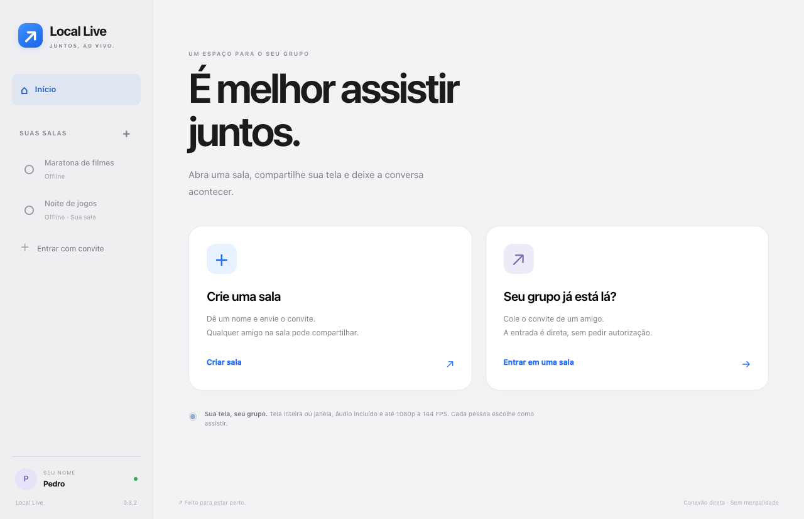
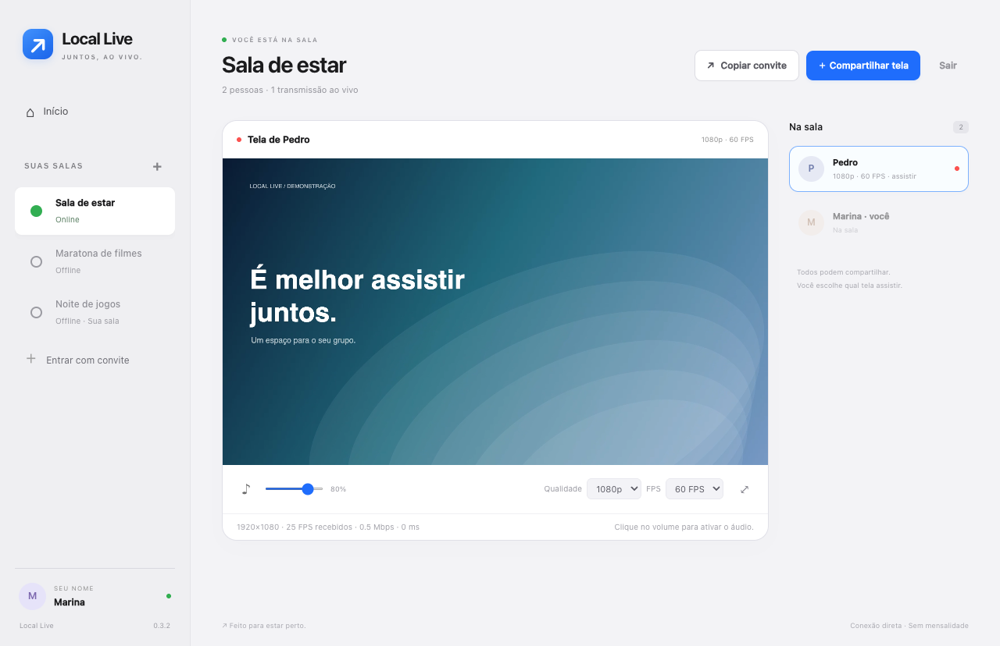
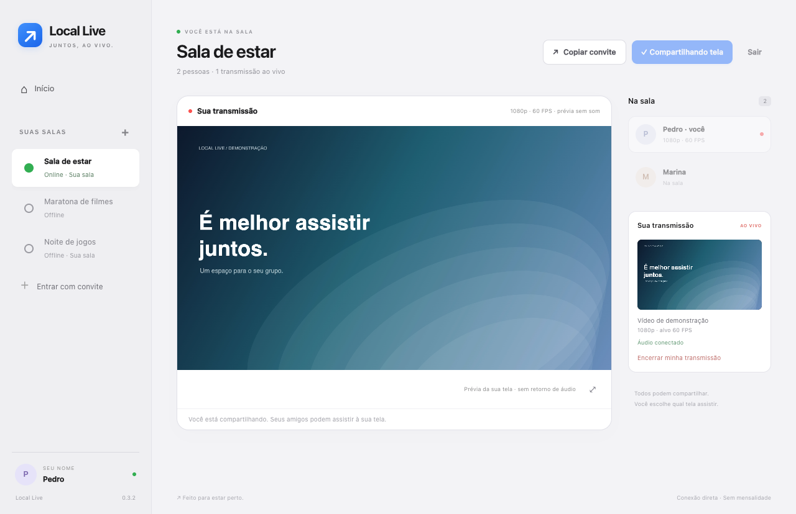
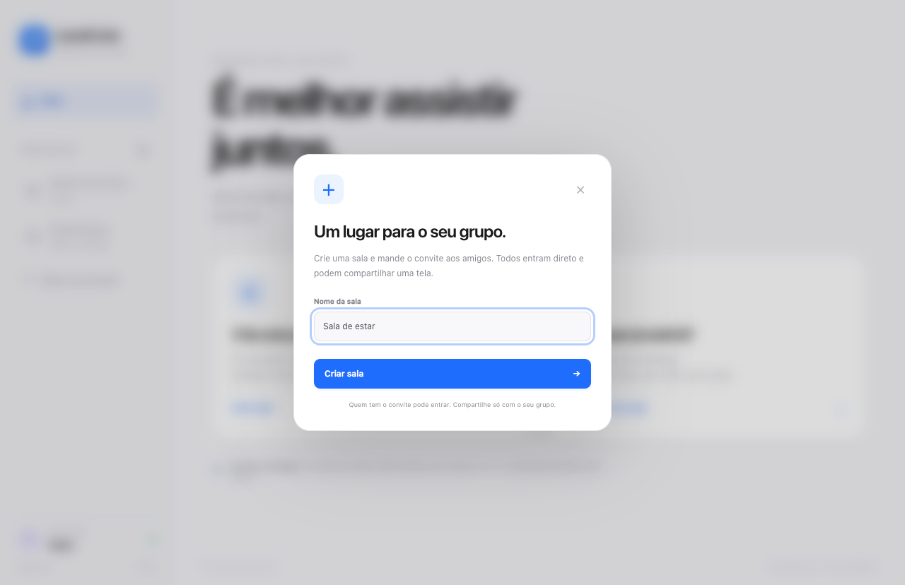

<div align="center">

# Local Live

### É melhor assistir juntos.

Salas privadas para compartilhar tela e áudio entre amigos.<br>
**macOS + Windows · 1080p · até 144 FPS · sem mensalidade**

[Começar](#começar) · [Como funciona](#como-funciona) · [Áudio confiável](#áudio-confiável) · [Desenvolvimento](#desenvolvimento)

</div>



## Uma sala. Várias telas. O seu grupo.

Crie uma sala com um nome, copie o convite e envie aos amigos. A entrada é direta. Qualquer participante pode compartilhar uma tela e assistir à transmissão de outra pessoa, tudo no mesmo lugar.

- **Salas salvas:** entre uma vez e volte pela barra lateral.
- **Disponibilidade real:** indicador verde para **Online**; salas **Offline** ficam cinza. A consulta periódica não entra na sala nem recebe mídia. Ao iniciar, **Verificando…** evita mostrar um estado inventado; falhas da sinalização aparecem como **Sem conexão**. Uma rede que bloqueia P2P pode tornar uma sala indisponível mesmo com o criador conectado.
- **Salas offline:** convites de outras pessoas ficam desabilitados enquanto a sala está Offline. Suas próprias salas continuam clicáveis para abri-las e mostram **Offline · Sua sala**. O rótulo **Sua sala** identifica suas salas também nos demais estados.
- **Sua tela no centro:** quando você está transmitindo sem assistir a outra tela, a prévia aparece no player principal, sempre sem reproduzir o próprio áudio. Os controles de qualidade/volume aparecem ao assistir a outra pessoa.
- **Compartilhamento independente:** encerrar sua tela mantém a sala e as outras transmissões.
- **Navegação sem interrupção:** abrir o Início mantém a sala, o compartilhamento e a transmissão assistida. Volte pelo botão **Voltar à sala** ou pela sala na lateral. Use **Sair** para desconectar.
- **Áudio incluído:** o jogo e os outros sons acompanham a tela; o Discord desktop é filtrado.
- **Volume individual:** cada espectador ajusta seu volume, inclusive para silenciar.
- **Qualidade sob medida:** resolução e FPS separados, sempre limitados à transmissão original.
- **Player ao vivo:** sem botão de pausa; tela cheia pelo botão ou duplo clique, com Esc para sair.
- **Interface leve:** tipografia do sistema, cores claras, espaços generosos e controles com rótulos diretos.



Quando só a sua tela está sendo compartilhada, ela aparece no centro:



As imagens mostram a interface real com vídeo de demonstração gerado para a documentação. Nenhuma tela pessoal ou chamada foi usada.

## Começar

1. Baixe o pacote da sua plataforma em [Releases](https://github.com/pedrcovre/local-live/releases).
2. Feche a versão anterior e extraia o ZIP inteiro. No Windows, abra `Local Live.exe`; no Mac, abra `Local Live.app`.
3. Preencha seu nome. Clique em **Crie uma sala** e dê um nome ao grupo.
4. Use **Copiar convite**. Seus amigos escolhem **Entrar com convite**; depois a sala fica salva.
5. Clique em **Compartilhar tela**, escolha resolução, FPS e limite de vídeo, e selecione uma tela inteira ou janela.
6. Clique na pessoa cuja tela quer assistir. Ajuste **Qualidade**, **FPS** e volume no player.

Para 144 FPS, escolha 144 na transmissão e na recepção. Se a transmissão for 720p/30, o espectador verá opções de até 720p e 30 FPS. A sala suporta várias telas publicadas, com **uma transmissão assistida por vez em cada aplicativo**, para reduzir banda e processamento.



### Quem mantém a sala aberta?

Quem criou a sala mantém o aplicativo conectado para coordenar participantes. Essa pessoa pode encerrar sua própria transmissão e continuar assistindo às outras. **Sair da sala ou fechar o aplicativo de quem criou encerra a sala para todos.** A sala salva pode ser aberta novamente depois. Não há um servidor alugado ou um computador separado dedicado a isso.

### Convites e privacidade

O convite usa `locallive://sala/…`, com a identidade da sala e uma chave aleatória de 192 bits. A interface mostra o nome e um botão de copiar; você não precisa lidar com códigos ET1. Quem tiver o convite pode entrar sem aprovação. Compartilhe-o apenas com seu grupo. O nome exibido é escolhido pelo participante e não verifica identidade.

A versão 0.3 usa um novo protocolo de salas: todos precisam atualizar. Salas antigas permanecem nos dados locais e convites ET1 podem ser lidos, mas clientes 0.2 não participam do protocolo novo. Criar uma sala nova e enviar seu convite é o caminho recomendado.

Preferências e convites ficam somente no diretório de dados do aplicativo, protegidos por `safeStorage` quando disponível. O repositório e os pacotes não incluem seus convites, sessões ou dados de usuário.

Se o armazenamento seguro estiver indisponível ou o arquivo salvo não puder ser lido, o app preserva o arquivo e avisa que as salas da sessão serão temporárias. A interface continua funcionando; reabra o app após recuperar o acesso ao armazenamento seguro para voltar às salas salvas.

## Áudio confiável

O processamento de captura usa uma saída silenciosa, independente do dispositivo físico de reprodução. A versão 0.3 trata interrupções de áudio sem exigir que a transmissão inteira seja reiniciada:

| Interrupção | Recuperação |
| --- | --- |
| Discord muda de processo | Recria o filtro e reabre o capturador, mantendo a sessão de áudio. |
| API nativa falha ou deixa de entregar PCM | Reabre a captura com tentativas espaçadas e proteção contra inicializações concorrentes. |
| O sistema suspende o AudioContext | Retoma o contexto automaticamente. |
| Relógio de áudio fica parado apesar de ativo | Recria o processamento sem depender da saída física de som do transmissor. |
| AudioContext é encerrado | Reconstrói o player PCM e substitui a faixa de áudio nos emissores WebRTC. |
| Pacotes de áudio deixam de chegar enquanto o vídeo continua | O receptor solicita recuperação ao transmissor. |
| Saída de áudio trava ou muda de dispositivo | Restaura o player de áudio independente, preservando o vídeo. |

Durante a recuperação, a interface mostra **Reconectando áudio…**. A captura não troca automaticamente para um modo que inclua a chamada. Silêncio na origem não é tratado como falha com base apenas no volume.

**macOS:** requer 14.2+ para o filtro de áudio. Exclui processos de áudio do Discord e do próprio Local Live. No macOS 15+, a tela/janela é escolhida pelo seletor nativo.

**Windows:** usa WASAPI Process Loopback num capturador próprio. Windows 11 é a plataforma Windows esperada. A API exclui uma árvore de processos; ao transmitir e assistir simultaneamente no Windows, o áudio assistido fica silenciado para evitar sua recaptura. A transmissão continua levando os sons do computador. Ao encerrar sua transmissão, o volume assistido volta ao valor escolhido.

Abra o **Discord desktop** e entre na chamada antes de compartilhar. Discord no navegador e outros aplicativos de chamada não são excluídos. Se não houver Discord aberto, o app captura os demais sons; caso ele apareça depois, o filtro é atualizado. A detecção é periódica e não oferece exclusão instantânea durante toda mudança de processo.

### Qualidade e FPS

Resoluções: **480p, 720p, 1080p**. FPS: **15, 30, 60, 120 e 144** na recepção, respeitando o limite da origem; a transmissão oferece 30/60/120/144. O limite de 10–100 Mbps é de **vídeo total por transmissor**, dividido entre seus espectadores. Áudio e overhead acrescentam tráfego.

A cadência fixa usa um worker independente da prévia. Se a captura entregar menos imagens, repete o último quadro; isso completa a cadência sem criar movimentos novos. Os contadores continuam medindo quadros reais codificados/decodificados. GPU, captura, rede e decodificador ainda podem limitar o resultado; 120/144 FPS exigem mais hardware e permanecem experimentais. Fontes menores são ampliadas com proporção preservada e bordas.

### Conexão

A sinalização usa o serviço gratuito do PeerJS e STUN do Google. A mídia vai diretamente entre os participantes por WebRTC. O criador coordena a sala, mas não retransmite os vídeos dos demais.

Não há TURN, VPN geral ou acesso remoto aos computadores. Algumas combinações de NAT/firewall podem impedir P2P. Limite de proteção: 12 participantes; esse limite não é uma promessa de desempenho com 12 transmissões.

### Permissões e avisos do sistema

Transmitir exige acesso à tela e ao áudio do sistema; conexões P2P podem exigir rede local. As APIs de captura são acionadas ao escolher compartilhar. Câmera e microfone são recusados pelo aplicativo; as descrições padrão de câmera, microfone e Bluetooth foram removidas do pacote Mac. Assistir e consultar disponibilidade não iniciam captura.

**Os alertas de aplicativo desconhecido ainda podem aparecer.** Este projeto não dispõe de certificados de distribuição. No Mac, o caminho oficial é Developer ID e notarização; a assinatura local usada nestes pacotes não substitui essa verificação. [Apple: distribuição com Developer ID](https://developer.apple.com/developer-id/).

No Windows, assinatura reconhecida permite identificar o editor, mas um programa novo ainda pode receber alerta de reputação; distribuição pela Microsoft Store segue outro fluxo de confiança. [Microsoft: reputação do SmartScreen](https://learn.microsoft.com/en-us/windows/apps/package-and-deploy/smartscreen-reputation).

O Chaves do macOS protege os convites salvos. Sem uma assinatura consistente reconhecida, atualizações podem provocar uma nova solicitação de acesso ao Chaves. [Electron: armazenamento seguro](https://www.electronjs.org/docs/latest/api/safe-storage). A seleção de tela e os consentimentos do sistema continuam sob controle do macOS. Instale uma única cópia em **Aplicativos**, feche a anterior antes de atualizar e evite alternar entre cópias extraídas em Downloads.

## Desenvolvimento

Requisitos: **Node.js 22+**, npm e sistema com suporte às APIs de captura.

```sh
npm ci
npm start
```

```sh
npm test
npm run test:integration
```

Os testes usam vídeo e áudio sintéticos. Verificam entrada direta, três participantes, duas transmissões simultâneas, volume, limites de resolução/FPS, áudio recebido por WebRTC, substituição de faixa audível sem trocar a chamada de vídeo e restauração de AudioContext suspenso/encerrado. A regressão de navegação verifica que transmissor e espectador podem ir ao Início e voltar mantendo a captura e a mesma chamada, com áudio/vídeo chegando enquanto a sala está fora da tela. Testes nativos simulam troca de processo, erro, fonte travada e cancelamento de tentativas pendentes.

As falhas injetadas e os testes automatizados não substituem uma sessão de várias horas em cada combinação de sistemas. A correção cobre os caminhos identificados no código; o teste prolongado em uma chamada real deve ser repetido após atualizar.

### Compilar pacotes

```sh
npm run dist:mac
npm run dist:win
```

Os binários nativos por plataforma ficam em `native-audio/`, com licenças. Para recompilar:

```sh
node scripts/build-native-mac.cjs
LOCAL_LIVE_WINDOWS_CXX=/caminho/para/x86_64-w64-mingw32-clang++ node scripts/build-native-win.cjs
```

A compilação Mac exige Xcode Command Line Tools e cabeçalhos Node (`LOCAL_LIVE_NODE_HEADERS`, padrão `/usr/local/include/node`). O código Mac e sua procedência estão em `vendor/native-audio-node/`; o capturador Windows está em `native/windows/audio-helper.cpp`. Quem baixa os pacotes prontos não precisa de Node, compilador ou drivers adicionais.

### Estrutura

```text
src/room.js              coordenação da sala e mídia P2P
src/room-protocol.cjs    convites e limites de qualidade
src/audio.cjs            captura nativa e reconexão
src/filtered-audio.js    recuperação do grafo Web Audio
src/video-worker.js     cadência e normalização de vídeo
src/renderer.js          interface e controles
native/                 fonte do capturador Windows
vendor/                 fonte/licença do componente Mac
native-audio/           binários distribuídos
```

## Referências e licença

[Electron](https://www.electronjs.org/docs/latest/api/session) · [PeerJS](https://peerjs.com/) · [Captura por processo da Microsoft](https://github.com/microsoft/Windows-classic-samples/tree/main/Samples/ApplicationLoopback) · [native-audio-node](https://github.com/predict-woo/native-audio-node)

MIT. Veja [LICENSE](LICENSE) e os avisos dos componentes nativos. Marca, código e documentação do Local Live são mantidos neste repositório privado.
